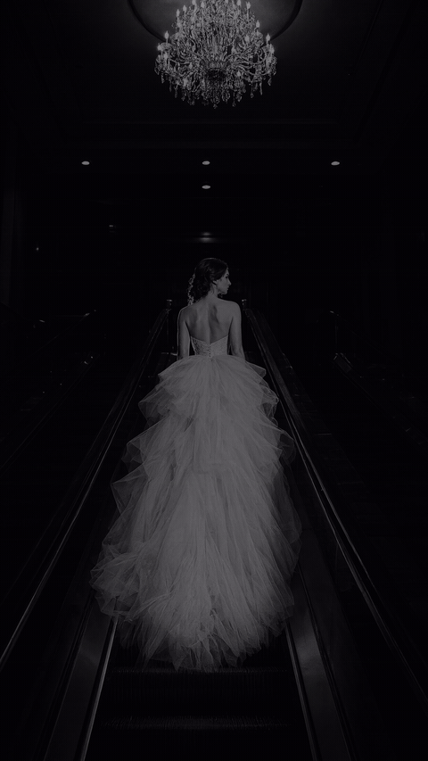
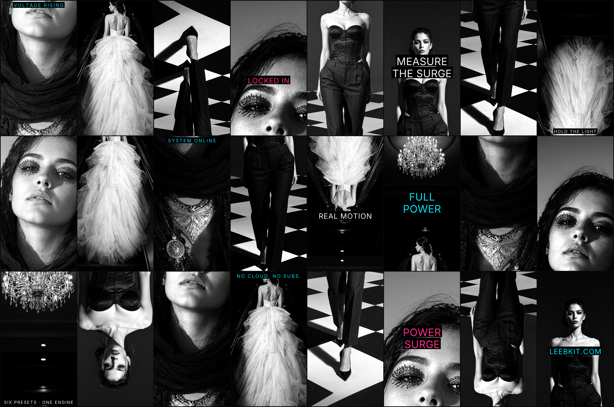
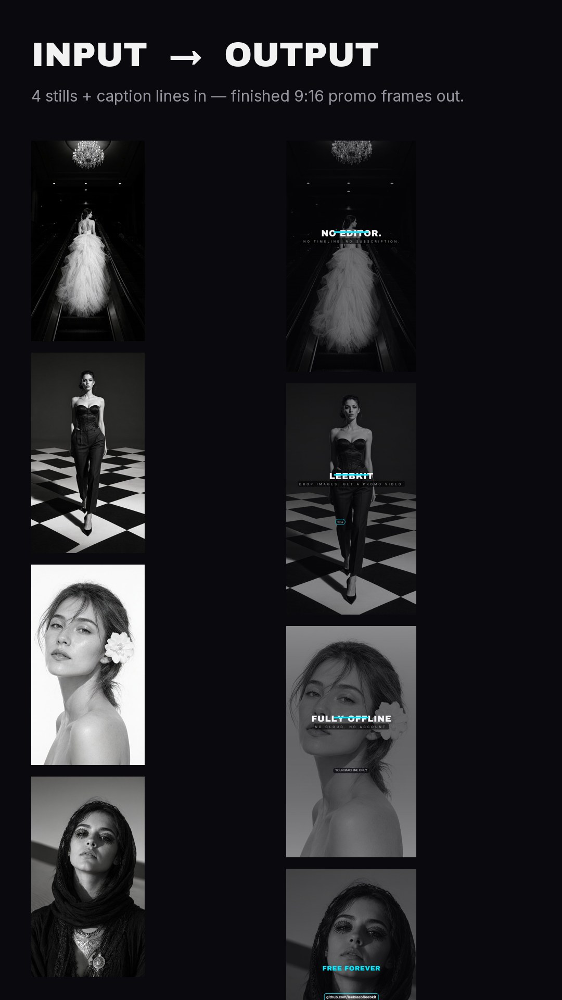

# LEEBKIT — by LEEBLAAB

**Kinetic promo videos. No cloud. No API. No subscription.**



Full 20s video with voiceover + music:
https://github.com/leeblaab/leebkit/releases/download/v1.4/promo_v14.mp4
(v1.3 cut still available at the v1.3 release.)
*Same project JSON ships in `samples/promo_v12.json` (its 4 stills in
`samples/media/`), reproducible with one command below.*

## The v1.4 look — every preset and caption kind, one grid



**Hardware floor: any machine that runs Python 3.11+/ffmpeg — no GPU, no cloud.** The whole
pipeline is pure Pillow/numpy + ffmpeg; if Python and ffmpeg run, LEEBKIT renders.

| Benchmark (measured, not estimated) | Result |
|---|---|
| 12s promo, 1080×1920 @30fps, 360 frames, full audio (VO + music bed) | **~17 s wall-clock end-to-end** (headless `render_cli.py --jobs 8`, warm run; frame pipeline ~14 s of that. The web app renders one job at a time but each job parallelizes its frames too) |
| Output spec (ffprobe) | h264 1080×1920 30fps + aac, duration gate passes |
| Machine | Windows 11 laptop, CPU-only (`--jobs 8`), Python 3.14 dev venv — release line runs 3.11–3.13 |

A full 30s promo renders roughly 2.5× the frame count above — expect low tens of seconds on a
modern CPU. The numbers above are this machine's actual wall-clock timings (render_cli.py +
ffprobe); your mileage will vary with CPU cores — no other numbers claimed here.

LEEBKIT turns 1–10 still images + captions into a finished vertical promo MP4 — animated
stills (Ken Burns), kinetic text, transitions, voiceover and music with auto-ducking —
rendered entirely on your machine by Python + ffmpeg. Double-click `start.bat`, open the
webUI, get an MP4.

**Status: v1.4 — November 2026.** Everything listed below is built and in daily use.
v1.4 adds: eight kinetic caption kinds — `kicker` (rule + tracked caps stagger), `burst`
(scale-punch word, per-word color), plus `wipe`, `split`, `slam`, `trackin`, `flashpop`,
`maskline` — all metrics/checker parity with the renderer; a composition layer so any
shot can override its layout (`layout: {frac}`) and any caption line takes `align:
left|center`; per-scene photo slots when loading a template draft (drag-drop or click to
pick); three new palettes (`volt`, `signal`, `chrome`) plus `onyx`, with five extra OFL
display fonts; music picker with friendly CC0 bed names + upload-your-own MP3 row
(same sniff/cap hardening as image uploads); recent-projects dropdown (mtime-sorted,
load-from-folder); music audition toggle; `start.bat` opens the browser only once the
port answers and self-heals a stale venv safely. Share teasers: `--gif` (640px/6s/12fps
cap) and `--webp`. Golden corpus now 1314 hashed frames; CI runs smoke + golden on every
push (Linux) and the full corpus weekly (Windows).
v1.3 adds: golden-frame regression harness, wipe_left/wipe_up transitions with correct caption timing,
caption engine split into per-kind measure/draw modules so the pre-render checker and
the renderer share one source of truth (no more false overflow warnings), metrics cache
(measure once per shot, not per frame — long-text projects no longer pay the fit/shrink
loop on every single frame), and style previews: every preset renders a live
3-frame animated preview in the app before you commit to a look.
v1.2 adds: 9:16 + 1:1 + 16:9 format selector, sub-line auto-wrap, path-confinement + upload
hardening (all project-supplied image paths are confined to `media/`, absolute/traversal paths
rejected, 32MB upload cap + magic-byte sniff), missing-image abort instead of black frames,
one-click `LEEBKIT-setup.bat`, and this README's benchmark block. Project JSON image paths
are relative to `media/` from v1.2 on (e.g. `"uploads/x.png"`).
License: AGPL-3.0-only (code) — presets and commercial content packs stay proprietary to LEEBLAAB.

---

## Before → after (decide in 10 seconds)

Input is 4 stills + typed caption lines. Output is the frames below — rendered by LEEBKIT,
same project JSON you'd get from `samples/promo_v12.json`:



## What it does

- **Three formats** — 9:16 (1080×1920), 1:1 (1080×1080) and 16:9 (1920×1080) @30fps, chosen
  per project in the UI; layouts are preset-driven (`core/layout.py`).
- **Upload up to 10 images** — drag-drop or file picker; reorder shots by dragging cards.
- **Shot planner** — one card per shot: image, on-screen caption lines, spoken VO line,
  duration chips (4s / 4.8s / 6s…), transition-in style, camera-move style. Durations
  must sum to the target length (15/30/60s) — enforced live in the UI.
- **Plan generator** — type one idea-prompt, get a full shot plan (rule-based template
  filler — no LLM, no network).
- **Storyboard** — one instant frame per shot to check composition before rendering;
  plus pre-render red-flag checks: VO longer than its shot window, caption wider than
  safe width at the chosen font, empty image slot.
- **Voiceover** — local Piper TTS (offline neural voices, ~170MB one-time download via
  `setup_vo.bat`, SHA256-verified), per-line preview (~1s), "no VO" option; auto-fit
  durations when VO runs long.
- **Music** — procedural soundtrack generator (numpy synthwave bed — no audio files
  shipped) + your own MP3/WAV beds in `music/`; automatic ducking under VO (~45%, 0.12s ramps).
- **Terminal-bar shot type** — a fake terminal scene whose progress bar animates 0→100%
  automatically over the shot's duration; the text stays editable, the bar is derived.
- **Title auto-wrap** — big display titles AND small caption/sub lines measure themselves and
  wrap/scale to stay inside the frame; hard cuts render cleanly with zero overlay bleed
  between shots.
- **Presets** — seven looks: `leebdark` (LEEBLAAB house style), `neonlight`, `volt`,
  `signal`, `chrome`, `onyx`, plus format variants; all JSON hand-editable. `drafts/`
  ships working template projects showing every kinetic kind in action.
- **Render queue** — background job, live frame-counter progress over websocket; every
  render ends with an ffprobe both-streams duration gate, so a mux desync fails loudly.
- **CLI renderer** — `render_cli.py` runs the same engine headless, with parallel frame
  jobs (`--jobs N`) and `--draft` / `--no-audio` modes.
- **Incremental render** — unchanged shots are not re-rendered.
- **Path confinement + input hardening** — project-supplied image paths can never escape
  `media/` (absolute and `..` paths rejected); uploads capped at 32MB with magic-byte sniff;
  a missing shot image aborts the render with a clear error instead of black frames.
- **Projects are files** — one human-readable JSON per promo in `projects/` (`"schema": 1`;
  old project files stay loadable forever). No database.

## Use LEEBKIT with ChatGPT / Claude

The app itself has no AI — but a project file is just JSON, so any chatbot can author one
for you. Bring your own ChatGPT/Claude: paste the brief below, get a valid project back,
render it locally. The engine never phones home either way; the chatbot runs on your machine's
terms, and every unknown value in the JSON fails loudly at save time with the exact fix.

**Brief to paste into ChatGPT/Claude** (copy everything between the lines):

---

Write me a LEEBKIT promo project as a single JSON object — no markdown fences, no commentary.
Contract:

- Top level: `"schema": 1` (exactly), `"name"`, `"preset"` (one of `leebdark`, `neonlight`, `volt`, `signal`, `chrome`, `onyx`),
  `"size"` (`"720x1280"`, `"1080x1920"` or `"1440x2560"` for vertical; square/landscape like
  `"1080x1080"`, `"1920x1080"` also fine), `"target"` (total seconds, e.g. 30.0), `"fps"` (24 or 30).
- Optional voiceover: `"voice"` (e.g. `"en_US-lessac-medium"`) and `"vo_lines"`:
  `[{"shot": <shot index>, "offset": <seconds into that shot>, "text": "..."}]`. Keep each line
  short enough to speak inside its shot (roughly 3 words/second).
- Optional music: `"music": {"mode": "procedural", "bed": "<bed>"}` where bed is one of
  `synthwave`, `pulse`, `low_drive`, `sparkle`, `ambient_glow`; or `{"mode": "none"}`;
  or `{"mode": "file", "bed": "track.mp3"}` for a file in the app's `music/` folder.
- `"shots"`: array of shots. Each shot: `"image"` (a path relative to the app's `media/`
  folder — I will tell you the filenames), or no image at all if it uses a background
  generator; `"t"` (seconds, 0.5–15) and **the `t` values must sum exactly to `"target"`**;
  `"transition"` one of: `cut`, `wipe_left`, `slideR`, `fade`, `whip`, `flashdip`, `wipe_up`;
  `"cam"` one of: `pushin`, `pushin2`, `pushout`, `pandown`, `panup`, `pandiag`;
  optional `"dim"` (0–1, darkens the image behind captions).
- Backgrounds without photos: add `"fill": "gen:<preset>"` with preset one of
  `midnight_drift`, `grid_pulse`, `paper_grain`, `ember_flow`, `deep_current`, `signal_field`,
  plus optional `"motion": "normal"` or `"subtle"`.
- Captions per shot: `"captions": [{"kind": ..., "at": <seconds into shot, within 0..t>, ...}]`.
  Kinds and their payload: `title_block` (`text`, optional `sub`), `small` (`text`),
  `cta` (`text`), `panel_top` / `panel_mid` (`lines`: array of strings),
  `chips` (`items`: array of short strings), `cap_lines` (array in `"lines"`),
  `kicker` (`text`, optional `rule`), `burst` (`word`, optional `color`), `terminal`
  (`rows`: array of strings; progress bar is derived).
- Use ALL CAPS for big titles, lowercase for small lines. No fields beyond this contract.

My promo: <describe your product/offer, tone, and length>. My image files: <list them>.

---

**Then render it:** save the JSON into `projects/` (or anywhere), put your images under
`media/`, and either open the app and load the project, or straight from a terminal:

```
python render_cli.py projects/my_promo.json --media media --out output/my_promo.mp4 --jobs 8
```

Wrong generator name, typo'd transition or off-budget duration sum? The CLI prints one clear
line naming the shot and the valid choices — paste that line back to the chatbot and it fixes
the file. Share teasers: add `--gif` (≤6s/640px) or `--webp` (≤8s/960px).

## Explicitly out (by design)

Image generation of any kind, LLMs anywhere, network calls after setup. The prompt box is
a template filler, not AI — the AI-workflow section above is bring-your-own-chatbot *authoring*
of a plain JSON file, with zero AI in the app itself. Batch multi-project render and 2K/4K are
future-tier ideas.

## Requirements

- Windows 10/11 (the `.bat` launchers; the Python core itself is cross-platform).
- **Python 3.11–3.13** on PATH — not 3.14 yet (its `wave` module breaks Piper's CLI output;
  `start.bat` uses whatever `python` resolves to and rebuilds a stale venv automatically).
- **ffmpeg + ffprobe** on PATH.
- Optional (voiceover): run `setup_vo.bat` once — fetches Piper voices from
  rhasspy/piper-voices with SHA256 verification, plus a Python 3.11 interpreter if missing.
  Everything else works without it (`--no-audio`).

## Quick start

```
LEEBKIT-setup.bat   # one-click: checks Python, fetches portable ffmpeg if missing, launches the app
start.bat           # or straight to the app: creates .venv + installs deps, opens http://127.0.0.1:8735
```

**Security note:** the app has no auth — it binds 127.0.0.1 only (loopback), so it is reachable from this machine alone. Do not expose port 8735 beyond localhost.

`docs/QUICKSTART.md` walks a first video in under 5 minutes. CLI render without the browser:

```
python render_cli.py samples/promo_v12.json --media samples/media --out output/promo.mp4 --jobs 8
```

(Image paths in project JSON are relative to `media/`; pass `--media DIR` to point elsewhere.)

## Product pillars (every decision passes these)

1. **Light** — stdlib + FastAPI + Pillow + numpy + Piper only. No frontend framework,
   no build step, no database. One folder, one `.bat`.
2. **Offline** — zero network calls after the one-time voice-model download. Never any API key.
3. **Easy to use** — a stranger must produce a good video in under 5 minutes with zero docs.
4. **Fast** — storyboard preview < 10s; full render streams progress; nothing re-renders that didn't change.
5. **TOP-skilled UI polish on a simple surface** — dark, flush, typographic interface
   (near-black `#0a0a0e`, cyan accent `#00e5ff`, white bold type), micro-animations,
   keyboard shortcuts, honest progress.

If a feature conflicts with these pillars, cut the feature.

## Brand rules

- Product name: **LEEBKIT**. Byline everywhere: **LEEBKIT by LEEBLAAB** (maker credit, not co-brand).
- Tagline carries the offline promise: "No cloud. No API. No subscription." — never in the logo itself.
- Author for this product line: **LEEBLAAB**.
- Fonts: open licenses only — Archivo Black / Inter (headings, body), JetBrains Mono
  (terminal/mono), bundled in `assets/fonts/` — credits in `ATTRIBUTIONS.md`.

## Repo layout

```
LEEBKIT-setup.bat    one-click installer: Python check + portable ffmpeg fetch, launches app
start.bat            first-run venv + deps, opens http://127.0.0.1:8735
setup_vo.bat         one-time Piper voice download (SHA256-verified)
app.py               FastAPI: static UI + /api/* endpoints + websocket progress
render_cli.py        headless renderer (parallel --jobs, ffmpeg encode, ffprobe gate)
core/engine.py       frame compositor: Ken Burns, kinetic text, transitions, terminal bar
core/layout.py       per-format layout tables (9:16 / 1:1 / 16:9)
core/audio.py        Piper VO pipeline, procedural music, ducking, mux
core/checks.py       pre-render red-flag checks (pixel-measured, not eyeballed)
core/queue.py        background render queue with progress broadcast
ui/index.html        the entire frontend — single-page vanilla JS/CSS, no framework
presets/             seven hand-editable styles (leebdark, neonlight, volt, signal,
                     chrome, onyx + variants)
drafts/              template showcase projects using every kinetic caption kind
music/               CC0 music beds + provenance ledger (ATTRIBUTIONS.md)
samples/             example project JSON + 4 sample stills (fully reproducible render)
assets/fonts/        bundled OFL fonts
docs/QUICKSTART.md
```

`projects/`, `media/`, `output/`, `frames/`, `vo/models/` are git-ignored — your saves,
uploads and renders never leave your machine.

## Contributing

PRs for bug fixes welcome; open an issue before big features — the pillars above are the
filter. Every push runs the smoke suite + sampled golden frames on Linux, and the full
golden corpus (1314 hashed frames) weekly on Windows — pixel drift fails CI. DCO sign-off
required (`CONTRIBUTING.md`). Keep anything commercial out of this repo:
preset/content packs and future Pro-tier features stay proprietary to LEEBLAAB.

## License

AGPL-3.0-only for the code (`LICENSE`, © 2026 LEEBLAAB). Presets, bundled font credits and
any commercial content packs remain LEEBLAAB property. Third-party credits: `ATTRIBUTIONS.md`.
