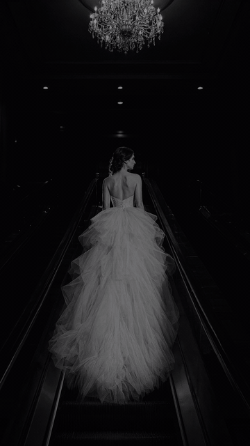

# LEEBKIT — by LEEBLAAB

**Kinetic promo videos. No cloud. No API. No subscription.**



Full video with voiceover + music:
https://github.com/leeblaab/leebkit/releases/download/v1.0/demo.mp4
*(v1.2 release swaps this link for the new `promo_v12.mp4` — same project JSON in
`samples/promo_v12.json`, reproducible with one command below.)*

**Hardware floor: any machine that runs Python 3.11+/ffmpeg — no GPU, no cloud.** The whole
pipeline is pure Pillow/numpy + ffmpeg; if Python and ffmpeg run, LEEBKIT renders.

| Benchmark (measured, not estimated) | Result |
|---|---|
| 12s promo, 1080×1920 @30fps, 360 frames, full audio (VO + music bed) | **8.3 s wall-clock** |
| Output spec (ffprobe) | h264 1080×1920 30fps + aac, duration gate passes |
| Machine | Windows 11 laptop, CPU-only (`--jobs 8`), Python 3.14 dev venv — release line runs 3.11–3.13 |

A full 30s promo renders roughly 2.5× the frame count above — expect low tens of seconds on a
modern CPU. The numbers above are this machine's actual wall-clock timings (render_cli.py +
ffprobe); your mileage will vary with CPU cores — no other numbers claimed here.

LEEBKIT turns 1–10 still images + captions into a finished vertical promo MP4 — animated
stills (Ken Burns), kinetic text, transitions, voiceover and music with auto-ducking —
rendered entirely on your machine by Python + ffmpeg. Double-click `start.bat`, open the
webUI, get an MP4.

**Status: v1.2 — November 2026.** Everything listed below is built and in daily use.
v1.2 adds: sub-line auto-wrap, path-confinement + upload hardening (all project-supplied
image paths are confined to `media/`, absolute/traversal paths rejected, 32MB upload cap +
magic-byte sniff), missing-image abort instead of black frames, and this README's benchmark
block. Project JSON image paths are relative to `media/` from v1.2 on (e.g. `"uploads/x.png"`).
License: AGPL-3.0-only (code) — presets and commercial content packs stay proprietary to LEEBLAAB.

---

## Before → after (decide in 10 seconds)

Input is 4 stills + typed caption lines. Output is the frames below — rendered by LEEBKIT,
same project JSON you'd get from `samples/promo_v12.json`:


## What it does

- **9:16 only** — 1080×1920 @30fps (1:1 / 16:9 planned for a later v1.x — decision pending
  real-user feedback on which ratio matters first).
- **Upload up to 10 images** — drag-drop or file picker; reorder shots by dragging cards.
- **Shot planner** — one card per shot: image, on-screen caption lines, spoken VO line,
  duration chips (4s / 4.8s / 6s…), transition-in style, camera-move style. Durations
  must sum to the target length (15/30/60s) — enforced live in the UI.
- **Plan generator** — type one idea-prompt, get a full shot plan (rule-based template
  filler — no LLM, no network).
- **Storyboard** — one instant frame per shot to check composition before rendering;
  plus pre-render red-flag checks: VO longer than its shot window, caption wider than
  safe width at the chosen font, empty image slot.
- **Voiceover** — local Piper TTS (offline neural voices, ~170MB one-time download via
  `setup_vo.bat`, SHA256-verified), per-line preview (~1s), "no VO" option; auto-fit
  durations when VO runs long.
- **Music** — procedural soundtrack generator (numpy synthwave bed — no audio files
  shipped) + your own MP3/WAV beds in `music/`; automatic ducking under VO (~45%, 0.12s ramps).
- **Terminal-bar shot type** — a fake terminal scene whose progress bar animates 0→100%
  automatically over the shot's duration; the text stays editable, the bar is derived.
- **Title auto-wrap** — big display titles AND small caption/sub lines measure themselves and
  wrap/scale to stay inside the frame; hard cuts render cleanly with zero overlay bleed
  between shots.
- **Presets** — `leebdark` (LEEBLAAB house style) and `neonlight`, JSON hand-editable.
- **Render queue** — background job, live frame-counter progress over websocket; every
  render ends with an ffprobe both-streams duration gate, so a mux desync fails loudly.
- **CLI renderer** — `render_cli.py` runs the same engine headless, with parallel frame
  jobs (`--jobs N`) and `--draft` / `--no-audio` modes.
- **Incremental render** — unchanged shots are not re-rendered.
- **Projects are files** — one human-readable JSON per promo in `projects/` (`"schema": 1`;
  old project files stay loadable forever). No database.

## Explicitly out (by design)

Image generation of any kind, LLMs anywhere, network calls after setup. The prompt box is
a template filler, not AI. Batch multi-project render and 2K/4K are future-tier ideas.

## Requirements

- Windows 10/11 (the `.bat` launchers; the Python core itself is cross-platform).
- **Python 3.11–3.13** on PATH — not 3.14 yet (its `wave` module breaks Piper's CLI output;
  `start.bat` uses whatever `python` resolves to and rebuilds a stale venv automatically).
- **ffmpeg + ffprobe** on PATH.
- Optional (voiceover): run `setup_vo.bat` once — fetches Piper voices from
  rhasspy/piper-voices with SHA256 verification, plus a Python 3.11 interpreter if missing.
  Everything else works without it (`--no-audio`).

## Quick start

```
start.bat        # first run: creates .venv + installs requirements.txt, opens http://127.0.0.1:8735
```

`docs/QUICKSTART.md` walks a first video in under 5 minutes. CLI render without the browser:

```
python render_cli.py samples/promo_v12.json --out output/promo.mp4 --jobs 8
```

(Image paths in project JSON are relative to `media/`; pass `--media DIR` to point elsewhere.)

## Product pillars (every decision passes these)

1. **Light** — stdlib + FastAPI + Pillow + numpy + Piper only. No frontend framework,
   no build step, no database. One folder, one `.bat`.
2. **Offline** — zero network calls after the one-time voice-model download. Never any API key.
3. **Easy to use** — a stranger must produce a good video in under 5 minutes with zero docs.
4. **Fast** — storyboard preview < 10s; full render streams progress; nothing re-renders that didn't change.
5. **TOP-skilled UI polish on a simple surface** — dark, flush, typographic interface
   (near-black `#0a0a0e`, cyan accent `#00e5ff`, white bold type), micro-animations,
   keyboard shortcuts, honest progress.

If a feature conflicts with these pillars, cut the feature.

## Brand rules

- Product name: **LEEBKIT**. Byline everywhere: **LEEBKIT by LEEBLAAB** (maker credit, not co-brand).
- Tagline carries the offline promise: "No cloud. No API. No subscription." — never in the logo itself.
- Author for this product line: **LEEBLAAB**.
- Fonts: open licenses only — Archivo Black / Inter (headings, body), JetBrains Mono
  (terminal/mono), bundled in `assets/fonts/` — credits in `ATTRIBUTIONS.md`.

## Repo layout

```
start.bat            first-run venv + deps, opens http://127.0.0.1:8735
setup_vo.bat         one-time Piper voice download (SHA256-verified)
app.py               FastAPI: static UI + /api/* endpoints + websocket progress
render_cli.py        headless renderer (parallel --jobs, ffmpeg encode, ffprobe gate)
core/engine.py       frame compositor: Ken Burns, kinetic text, transitions, terminal bar
core/audio.py        Piper VO pipeline, procedural music, ducking, mux
core/checks.py       pre-render red-flag checks (pixel-measured, not eyeballed)
core/queue.py        background render queue with progress broadcast
ui/index.html        the entire frontend — single-page vanilla JS/CSS, no framework
presets/             leebdark.json, neonlight.json (hand-editable styles)
samples/             example project JSON (bring your own images)
assets/fonts/        bundled OFL fonts
docs/QUICKSTART.md
```

`projects/`, `media/`, `output/`, `frames/`, `vo/models/` are git-ignored — your saves,
uploads and renders never leave your machine.

## Contributing

PRs for bug fixes welcome; open an issue before big features — the pillars above are the
filter. DCO sign-off required (`CONTRIBUTING.md`). Keep anything commercial out of this repo:
preset/content packs and future Pro-tier features stay proprietary to LEEBLAAB.

## License

AGPL-3.0-only for the code (`LICENSE`, © 2026 LEEBLAAB). Presets, bundled font credits and
any commercial content packs remain LEEBLAAB property. Third-party credits: `ATTRIBUTIONS.md`.
